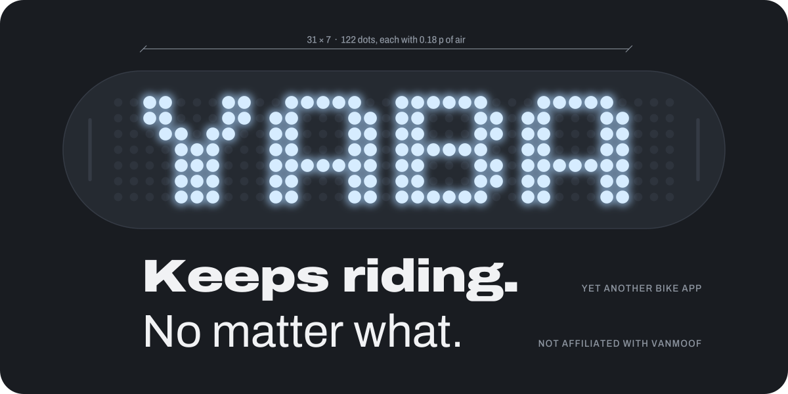
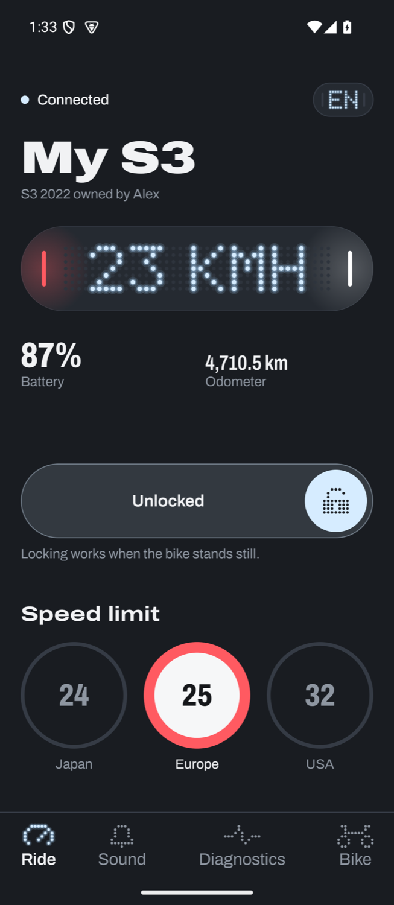
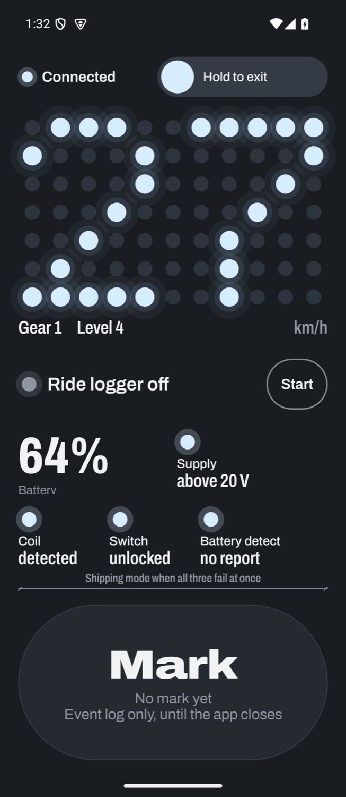
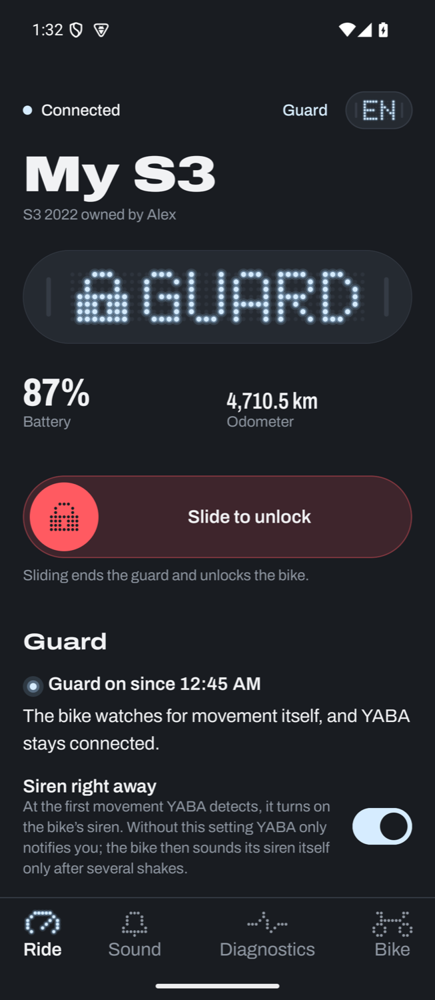
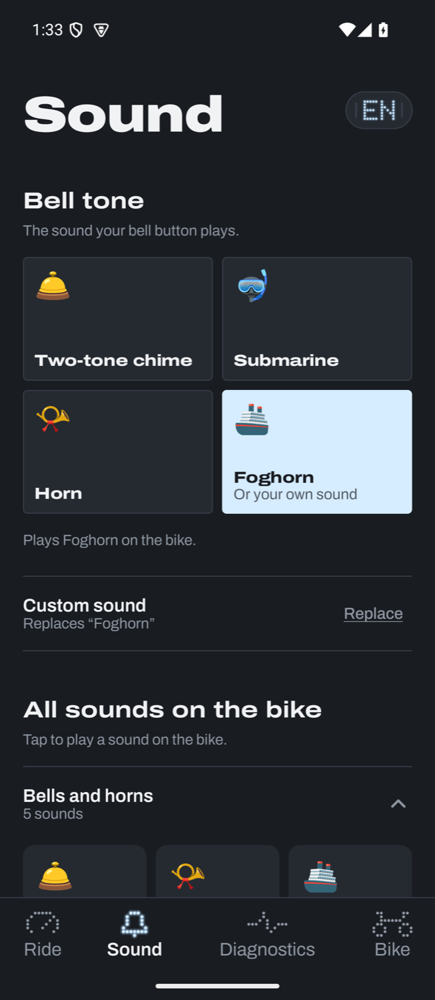
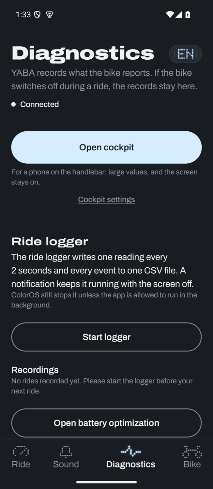
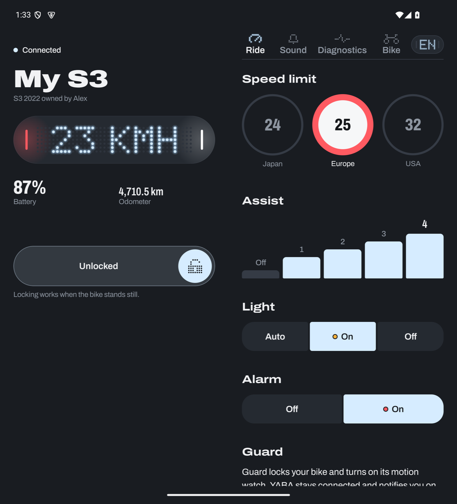

<p align="center">
  
</p>

<p align="center">
  <a href="https://github.com/stevendoerr-lachance/yaba/releases/latest"></a>
  
  
  
  
</p>

# YABA

Yet Another Bike App. A native Android app for VanMoof e-bikes that talks to the bike directly over
Bluetooth LE.

It fetches the bike key from the VanMoof account once and stores it encrypted on the phone
(Android Keystore). After that it works without VanMoof's servers.

I built it in Frankfurt for my second-hand S3.

<p align="center">
  
  
  
  
  
</p>

## What it does

| | What you get |
|---|---|
| **Ride** | Slide to unlock, assist 0 to 4, lights, alarm, touch unlock. The dot matrix shows speed and status. |
| **Cockpit** | Phone on the handlebar: large speed, gear, assist and the signals behind the shipping-mode fault. |
| **Guard** | Locks the bike, arms its own motion watch, keeps the link with the screen off and notifies your phone when the bike moves. Optional siren. |
| **Sound** | Bell tone, your own bell from any audio file (converted on the phone), ten bundled bells, every sound the bike knows, volume per sound. |
| **Diagnostics** | Live status, decoded fault bits, a ride logger (CSV, one reading every 2 seconds), readout of the bike's internal log. |
| **Bike** | Firmware versions, odometer, units, backup code, key backup and import, several bikes. |
| **Lab** | E-shifter shift points and Speed++ (see below). |

Seven languages: English, German, Dutch, French, Italian, Croatian, Russian.

## Supported bikes

| Bike | Status |
|---|---|
| VanMoof S3 / X3 | Everything above. Tested on an S3 with firmware 1.9.3. |
| VanMoof Electrified S2 / X2 | Lock, lights, assist, alarm, bell, diagnostics. Protocol ported from OldMoofKit. |


### Speed regions and Speed++

The bike knows three speed regions: Japan 24, Europe 25, USA 32 km/h.

Speed++ sets a 28″ bike to the 24″ wheel setting. The bike then measures 84 % of the real speed,
so assist ends at about 29.7 km/h instead of 25. The bike's own speedo and odometer read low by
the same factor. YABA multiplies by 1.1875 and shows the real speed everywhere. Check what is
legal where you ride.

<br clear="right">

## Foldables

On a book-style foldable the app uses two panes, split at the hinge.

<p align="center">
  
</p>

## Bundled bells

Ten bells come with the app. [`tools/bells/make_bells.py`](tools/bells/make_bells.py) synthesises
them from sine partials and filtered noise, tuned for the small speaker in the frame. All ten are CC0.

| | Bell | What you hear |
|---|---|---|
| 🚲 | Ring ring | A rotary thumb bell, two pushes |
| 🚋 | Tram | Zagreb tram gong: ding ... ding |
| 🤡 | Clown honk | Rubber bulb horn, twice |
| 📣 | Stadium horn | Air horn, three blasts |
| 🎺 | Fanfare | Two trumpets and a trombone in D |
| 🪳 | La Cucaracha | The folk tune on a musical car horn |
| 😢 | Sad trombone | Wah wah wah waaah |
| 🌙 | Night shift | A lounge sting with a bass slide |
| 👾 | YABA jingle | Five notes of chiptune |
| 🛸 | UFO | A theremin flying saucer |

## Dutch curses

<p align="center">
  
</p>

Now and then the dot matrix in the app curses in Dutch. Rarely, and never while you ride. The
error text below it stays polite. It can be switched off.

| On the tube | Literally | Meant |
|---|---|---|
| `GEDOE` | fuss | trouble, bother |
| `BALEN` | to be annoyed | what a pity |
| `NOU JA` | well, yes | oh well |
| `HE HE` | at last | phew |
| `AUW` | ouch | that hurt |
| `VERDORIE` | a softened "verdomme" | darn it |
| `DE PIJP UIT` | out of the pipe | finished, over |

## Install

Get the APK from [Releases](https://github.com/stevendoerr-lachance/yaba/releases/latest).
`universal` runs everywhere. If you want the exact one: `arm64-v8a` for almost every phone made
since 2017, `armeabi-v7a` for older ones, `x86_64` for emulators.

Allow installs from your browser or file manager, open the APK, sign in to your VanMoof account
once. Close the official VanMoof app while using YABA: the bike accepts one Bluetooth connection
at a time.

## Build

Needs JDK 17 and the Android SDK (platform 35, build-tools 35.0.0). Point `local.properties` at the SDK:

```
sdk.dir=/path/to/android-sdk
```

```bash
./gradlew :app:assembleDebug
```

```bash
./gradlew :app:testDebugUnitTest
```

651 unit tests cover the protocol, the crypto, the guard state machine and the log parsers. They run without a bike.

## Code

| Path | What lives there |
|---|---|
| `app/src/main/java/dev/steven/s3control/ble` | Protocol, crypto, GATT client, drivers for S3 and S2, guard logic |
| `.../data` | Account API, key vault |
| `.../ride` | Ride logger, guard service, log parsers |
| `.../ui` | Jetpack Compose: screens, the dot matrix, the cockpit, the opening film |
| `tools/bells` | The bell synthesiser |
| `tools/readme` | Draws the art on this page from the app's own font, palette and icon |

The dot matrix, the tube, the tab bar glyphs and the opening film are drawn in code. There are no image assets.

## Credits

Protocol knowledge comes from [mooovy](https://github.com/mjarkk/vanmoof-web-controller) (mjarkk),
[VanMoofKit](https://github.com/SvenTiigi/VanMoofKit) (SvenTiigi), pymoof (quantsini),
[OldMoofKit](https://github.com/Jegge/OldMoofKit) (Jegge, MIT) and the S3 firmware notes by Knight1.
No VanMoof code, firmware or sound files are part of this repository.

Fonts: Archivo and Roboto Flex (SIL OFL, see `licenses/`).

## License

MIT, see [LICENSE](LICENSE).

<p align="center">
  <br>
  <sub>Not affiliated with VanMoof. Not an official VanMoof app. Use at your own risk.</sub>
</p>
